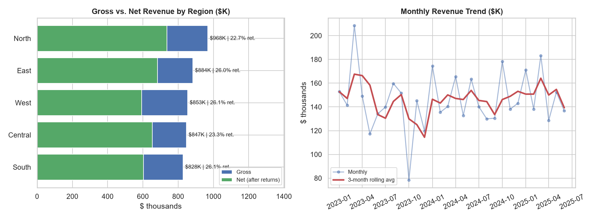
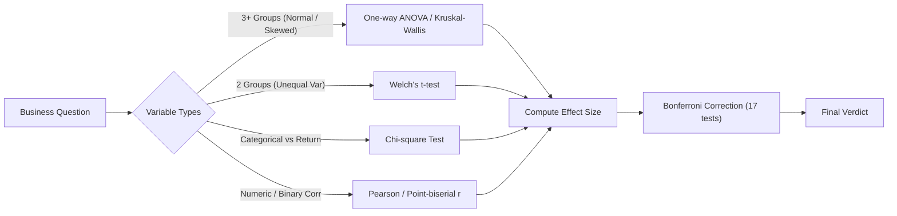
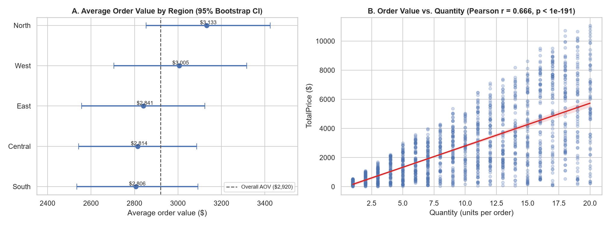
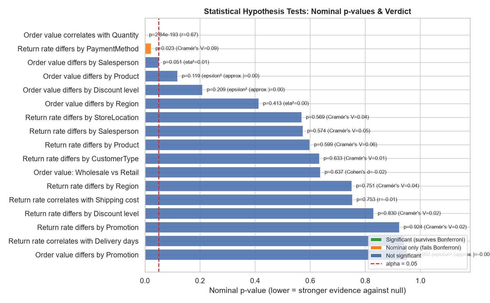
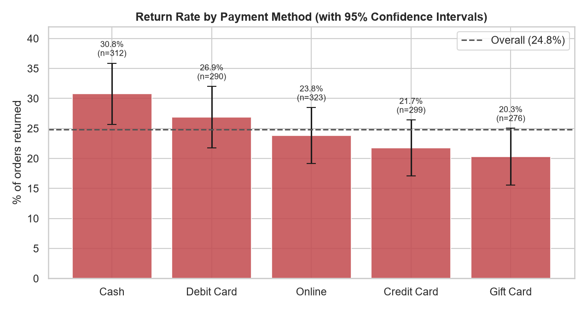

# Product Sales by Region — End-to-End Analysis & Interactive Dashboard


An end-to-end exploratory data analysis, statistical testing suite, and interactive Streamlit dashboard built on **1,500 regional product orders** (`Jan 2023 – Jun 2025`), developed with **AI-assisted data analysis** workflows.

The project answers five core business questions:
1. How much revenue is generated, and how much is lost to returns?
2. Which regions, products, channels, and salespeople perform best?
3. How is performance changing over time?
4. Do discounts and promotions measurably increase order value or reduce returns?
5. Which observed differences are statistically significant versus random noise?

<details>
<summary><strong>Table of Contents</strong></summary>

- [Repository Structure](#repository-structure)
- [Dataset Overview](#dataset-overview)
- [Getting Started](#getting-started)
- [Step-by-Step Analysis Pipeline](#step-by-step-analysis-pipeline)
- [Interactive Dashboard (streamlit_app.py)](#interactive-dashboard-streamlit_apppy)
- [Key Findings & Recommendations](#key-findings--recommendations)
- [AI-Assisted Data Analysis](#ai-assisted-data-analysis)

</details>

---

## Repository Structure

```text
.
├── Product-Sales-Region.xlsx        # Raw dataset (1,500 rows × 19 columns)
├── Product_Sales_Analysis.ipynb     # End-to-end analysis, statistical tests & static dashboard
├── streamlit_app.py                 # Interactive Streamlit + Altair dashboard with slicers & filters
├── README.md                        # Project documentation
├── assets/                          # Charts embedded in README.md
│   ├── business_performance_overview.png # Regional revenue & monthly trend overview
│   ├── hypothesis_tests_pvalues.png # Nominal p-values & Bonferroni verdicts across 17 tests
│   ├── return_rate_payment_ci.png   # Return rate by payment method with 95% CIs
│   └── statistical_ci_and_correlation.png # Regional AOV bootstrap CIs & Quantity correlation
└── outputs/                         # Generated by Product_Sales_Analysis.ipynb
    ├── sales_clean.csv              # Cleaned & feature-engineered dataset
    ├── hypothesis_tests.csv         # Statistical test results, effect sizes & corrected p-values
    └── sales_summary_tables.xlsx    # Multi-sheet Excel workbook (Region, Product, HalfYear, Payment, Salesperson, Hypothesis_Tests)
```

---

## Dataset Overview

- **Source:** `Product-Sales-Region.xlsx` (`Sheet1`)
- **Size:** 1,500 orders across 1,371 unique customers
- **Date Range:** `2023-01-01` to `2025-06-30`

### Raw Data Dictionary

| Column | Description |
|---|---|
| `Date` / `OrderDate` | Order date (duplicate columns in raw data; `Date` is dropped after validation) |
| `DeliveryDate` | Date the order was delivered |
| `Region`, `RegionManager` | Sales region (`Central`, `East`, `North`, `South`, `West`) and assigned manager |
| `StoreLocation` | Fulfilling store (`Store A` – `Store D`) |
| `Product` | Product category (`Chair`, `Desk`, `Laptop`, `Monitor`, `Phone`, `Printer`, `Tablet`) |
| `Quantity`, `UnitPrice` | Units ordered and price per unit (`$`) |
| `Discount` | Fractional discount applied (`0.00`, `0.05`, `0.10`, `0.15`) |
| `TotalPrice` | Final order value after discount |
| `ShippingCost` | Shipping charge for the order |
| `CustomerType`, `CustomerName` | `Retail` vs `Wholesale`, and customer identifier |
| `Salesperson` | Salesperson who took the order |
| `PaymentMethod`, `Promotion` | Payment method and promo code (`FREESHIP`, `SAVE10`, `WINTER15`, or missing) |
| `Returned` | `1` = order returned, `0` = not returned |
| `OrderID` | Unique order identifier |

---

## Getting Started

### 1. Prerequisites

Python 3.10+ is recommended. Install the required packages:

```bash
pip install pandas numpy matplotlib seaborn scipy openpyxl streamlit altair jupyter
```

### 2. Run the Interactive Dashboard

Launch the Streamlit app from the project root:

```bash
streamlit run streamlit_app.py
```

### 3. Run the Analysis Notebook

Open and execute `Product_Sales_Analysis.ipynb` in JupyterLab, VS Code, or Jupyter Notebook:

```bash
jupyter notebook Product_Sales_Analysis.ipynb
```

Running the notebook regenerates all files in `outputs/`.

---

## Step-by-Step Analysis Pipeline

`Product_Sales_Analysis.ipynb` is structured into 8 reproducible stages:

### Step 1 & 2: Setup and Data Loading
- Configures `matplotlib` / `seaborn` styling and fixes `RANDOM_STATE = 42` for reproducible bootstrap resampling.
- Loads `Product-Sales-Region.xlsx` into an untouched `raw` DataFrame and works on a separate `df` copy.

### Step 3: Data Cleaning & Validation
1. **Standardise names & text:** Strips leading/trailing whitespace from column names and all string columns.
2. **Fix data types:** Parses `Date`, `OrderDate`, and `DeliveryDate` with `pd.to_datetime(..., errors="coerce")`.
3. **Deduplicate:** Removes duplicate rows by `OrderID` (`keep="first"`).
4. **Handle missing values:** Fills missing `Promotion` values with `"None"` (no promotion applied).
5. **Validate business rules:** Verifies `Quantity > 0`, `UnitPrice > 0`, `Discount` in `[0, 1]`, `Returned` in `{0, 1}`, `DeliveryDate >= OrderDate`, `ShippingCost >= 0`, `Date == OrderDate`, and zero missing dates.
6. **Verify derived `TotalPrice`:** Confirms `TotalPrice` matches `Quantity * UnitPrice * (1 - Discount)`.
7. **Category consistency & redundancy:** Confirms 1-to-1 `Region` ↔ `RegionManager` mapping and drops the redundant `Date` column.

### Step 4: Feature Engineering
Creates 10 derived columns on `df` before saving the enriched dataset for downstream analysis and dashboarding:

1. **Extract calendar & period features:** Derive `Year`, `Month`, `Quarter`, `YearMonth` (month-start timestamp), and `Half` (`YYYY-H1` / `YYYY-H2`) from `OrderDate`.
2. **Decompose revenue & discounts:** Compute `GrossSales` (pre-discount), `DiscountAmount` (dollar discount given), `NetRevenue` (kept revenue), and `ReturnedRevenue` (revenue lost to returns).
3. **Measure fulfilment speed:** Compute `DeliveryDays` as `(DeliveryDate - OrderDate).dt.days`.
4. **Save the cleaned & engineered dataset (4.1):** Export `1,500 rows × 28 columns` to `outputs/sales_clean.csv` so downstream scripts and dashboards can reuse it without repeating cleaning.

| New column | Definition | Why it matters |
|---|---|---|
| `Year`, `Month`, `Quarter`, `YearMonth` | Parts of `OrderDate` | Time-based grouping and monthly trend analysis |
| `Half` | e.g. `2024-H1` (`Month <= 6` → `H1`, else `H2`) | Fair comparison of partial periods (2025 has only H1) |
| `GrossSales` | `Quantity * UnitPrice` | Revenue before discount |
| `DiscountAmount` | `GrossSales - TotalPrice` | Money given away through discounts |
| `DeliveryDays` | `(DeliveryDate - OrderDate).dt.days` | Fulfilment speed |
| `NetRevenue` | `TotalPrice` if `Returned == 0`, else `0.0` | Revenue actually kept |
| `ReturnedRevenue` | `TotalPrice` if `Returned == 1`, else `0.0` | Revenue lost to returns |

### Step 5: Exploratory Data Analysis (EDA)
Section 5 provides a comprehensive 12-part exploratory pass before hypothesis testing:
- **5.1 Numeric Summary:** Descriptive statistics (`count`, `mean`, `std`, quartiles, `min`/`max`) plus skewness across `Quantity`, `UnitPrice`, `Discount`, `GrossSales`, `DiscountAmount`, `TotalPrice`, `ShippingCost`, and `DeliveryDays`.
- **5.2 Distributions:** Histograms with KDE, mean, and median markers for continuous variables (`TotalPrice`, `Quantity`, `UnitPrice`, `ShippingCost`) and bar counts for discrete variables (`DeliveryDays`, `Discount`). Highlights right-skewness in `TotalPrice` (mean `$2,920` vs. median `$2,175`).
- **5.3 Category Balance:** Order-count bar charts across `Region`, `Product`, `CustomerType`, `PaymentMethod`, `Promotion`, and `Salesperson` to verify healthy sample sizes for group comparisons.
- **5.4 Outlier Detection:** `1.5 × IQR` rule applied to `TotalPrice`, `Quantity`, `UnitPrice`, `ShippingCost`, and `DeliveryDays`. Outliers are flagged and retained because they represent valid high-volume orders rather than data-entry errors.
- **5.5 Correlation Overview:** Pearson correlation heatmap across numeric variables and `Returned`, confirming mechanical `Quantity`–`TotalPrice` correlation and near-zero linear links between `Returned` and operational metrics.
- **5.6 Bivariate Distributions:** Boxplots of `TotalPrice` across `CustomerType` and `Product` (sorted by median), plus violin plots comparing kept (`0`) vs. returned (`1`) orders.
- **5.7 Customer Repeat-Purchase Behaviour:** Order frequency and total spend distribution across `1,371` unique customers (`91.0%` one-time buyers; `9.0%` / `124` repeat buyers with `2–4` orders).
- **5.8 Day-of-Week & Calendar-Month Seasonality:** Order volume by day of week (`Mon–Sun`) and average order value across calendar months (`1–12`).
- **5.9 Cross-Tabulation & Confounding Checks:** Heatmaps of `Region × StoreLocation` order counts and `PaymentMethod × CustomerType` shares to check for group imbalances before statistical testing.
- **5.10 Price–Quantity Relationship & Discount Dollar Impact:** Regression scatter plot of `UnitPrice` vs. `Quantity` and boxplots of `DiscountAmount` by `CustomerType` (`$347,900.51` total discounts given; avg `$231.93`/order, median `$113.34`).
- **5.11 Operational EDA (Delivery Time & Shipping Cost):** Regional and store-level comparisons of `DeliveryDays` (median `6–7` days across all regions) and `ShippingCost` (avg `$25.90–$28.45`).
- **5.12 EDA Summary & Key Takeaways:** Synthesizes distributional findings, customer concentration, category balance, and operational consistency to frame Sections 6 and 7.

### Step 6: Business Performance Analysis
- Headline KPIs and breakdowns across **Region**, **Product**, **Time** (monthly & half-year), **CustomerType**, **PaymentMethod**, **StoreLocation**, **Salesperson**, **Discounts & Promotions**, and **Return Drivers** (including delivery time & shipping cost).



### Step 7: Statistical Analysis
Section 7 tests whether observed business differences are real signals or random sampling noise across **four analytical pillars**:

1. **Confidence Intervals (7.1):**
   - **Average Order Value (AOV):** Computes both parametric t-based intervals and **5,000-sample bootstrap** intervals (`RANDOM_STATE = 42`), which are more reliable for right-skewed order totals. Overlapping regional CIs visually confirm why regional AOV differences are not significant.
   - **Return Rate:** Uses normal-approximation intervals for proportions (`1.96 × SE`), accurate at `n = 1,500`.
2. **Hypothesis Tests Across 17 Business Questions (7.2):**
   - **Order value across 3+ groups:** *One-way ANOVA* ($\eta^2$) for `Region` (`p = 0.413`) and `Salesperson` (`p = 0.051`, borderline); *Kruskal-Wallis* ($\epsilon^2$) for skewed `Product` (`p = 0.119`), `Discount` (`p = 0.209`), and `Promotion` (`p = 0.952`).
   - **Order value across 2 groups:** *Welch's t-test* (Cohen's $d = -0.024$) for `Wholesale` vs. `Retail` (`p = 0.637`).
   - **Categorical return-rate associations:** 8 *Chi-square tests of independence* (Cramér's $V$) across `Region`, `Product`, `CustomerType`, `Salesperson`, `PaymentMethod`, `StoreLocation`, `Promotion`, and `Discount`.
   - **Continuous & binary correlations:** *Pearson $r$* for `TotalPrice` vs. `Quantity` ($r = 0.666, p = 2.84 \times 10^{-193}$); *Point-biserial $r$* for `Returned` vs. `ShippingCost` ($r = -0.008, p = 0.753$) and `DeliveryDays` ($r = 0.002, p = 0.941$).
3. **Effect Sizes & Multiple-Testing Correction (7.2–7.3):**
   - Reports $\eta^2$, $\epsilon^2$, Cohen's $d$, Cramér's $V$, and $r$ alongside $p$-values to separate statistical significance from practical magnitude.
   - Applies **Bonferroni correction** across all 17 tests and exports the full table to `outputs/hypothesis_tests.csv`.
   - **Key takeaway:** Only `Quantity ↔ TotalPrice` survives correction (`p_bonf = 4.82e-192`). `PaymentMethod ↔ Returned` is *nominally significant* (`p = 0.023`, Cramér's $V = 0.087$, `31%` Cash vs `20%` Gift Card) but fails Bonferroni (`p_bonf = 0.395`), so it is flagged as a targeted hypothesis to investigate rather than a proven causal effect.









### Step 8: Storytelling, Dashboard & Exports
- Synthesizes findings, recommendations, and caveats.
- Renders a 9-panel static overview dashboard (`fig`, `20 × 17`) and exports `outputs/sales_summary_tables.xlsx` with 6 sheets (`Region`, `Product`, `HalfYear`, `Payment`, `Salesperson`, `Hypothesis_Tests`).

---

## Interactive Dashboard (`streamlit_app.py`)

`streamlit_app.py` turns the notebook's static summary dashboard into a live, user-controlled analytical tool using **Streamlit** and **Vega-Altair**.

### User-Controlled Slicers & Filters (Sidebar)
- **Order date range** (`st.date_input`)
- **Region** (multi-select pills)
- **Product** (multi-select dropdown)
- **Customer type** (`All` / `Retail` / `Wholesale`)
- **Return status** (`All` / `Not returned` / `Returned`)
- **More filters** (collapsible section): **Salesperson**, **Payment method**, **Promotion**, **Store location**, and **Discount rate**
- **Reset all filters** button to restore defaults in one click

### Dashboard Views
- **6 Live KPI Cards:** Gross revenue, Net revenue, Returned revenue, Return rate, Avg order value, and Orders / customers.
- **9 Interactive Charts (with hover tooltips):**
  - **A.** Revenue by region (`$K`, Gross vs Net)
  - **B.** Region × Product revenue heatmap (`$K`)
  - **C.** Monthly revenue trend with 3-month rolling average (`$K`)
  - **D.** Revenue by product (`$K`)
  - **E.** Salesperson average order value (`$`)
  - **F.** Return rate by payment method (`%`, with 95% CI error bars and overall mean reference line)
  - **G.** Promotions: average order value (`$`) & return rate
  - **H.** Average order value by discount rate (`$`)
  - **I.** Return rate by delivery time bucket (`2-4 days`, `5-7 days`, `8+ days`)
- **Data Export & Explorer:** One-click **Export filtered CSV** button and an expandable **Explore filtered orders** table.

---

## Key Findings & Recommendations

### Headline Numbers (Full Dataset)
- **Gross Revenue:** `$4.38M` across `1,500` orders (`$2,920` average order value)
- **Returned Revenue:** `$1.11M` (`24.8%` overall order return rate)
- **Net Revenue:** `$3.27M`

### Summary of Insights
1. **Returns are the largest lever:** Nearly 1 in 4 orders is returned, costing `$1.11M` in gross revenue; return reasons are not currently captured.
2. **Revenue is stable over time:** Mild second-half dips appear in 2023 and 2024, while H1 2025 (`$910K`) is flat vs H1 2024 (`$912K`).
3. **Region & product differences are small:** Differences in order value across regions (`p = 0.41`) and products (`p = 0.12`) are not statistically significant.
4. **Promotions & discounts show no measurable lift:** Promo orders and higher discount tiers (`15%`) do not produce larger baskets or lower return rates.
5. **Payment method warrants investigation:** Cash orders show a `31%` return rate vs `20%` for gift cards (nominally significant, though not after multiple-testing correction).
6. **Delivery speed & shipping cost do not drive returns:** Neither shipping cost (`p = 0.75`) nor delivery time (`p = 0.94`) correlates with returns.

### Priority Recommendations
1. **Capture `ReturnReason`** in the order system and run a returns root-cause review.
2. **Audit cash-order workflows** to understand why cash return rates are higher than gift card orders.
3. **Run controlled holdout tests** for promotions before renewing promotional spend.
4. **Add discount guardrails** (e.g., above 10%) since deeper discounts are not linked to larger orders.
5. **Track product cost and margin data** so discounting and return decisions can be evaluated on profit rather than revenue alone.

---

## AI-Assisted Data Analysis

This project leverages **AI-assisted data analysis** to accelerate the end-to-end analytics workflow while maintaining reproducibility and statistical rigor:
- **Code & Pipeline Generation:** Structuring data validation checks, feature engineering, and automated Excel/CSV exports in `Product_Sales_Analysis.ipynb`.
- **Statistical Test Selection & Interpretation:** Mapping business questions to appropriate parametric and non-parametric tests (ANOVA, Kruskal-Wallis, Welch's t-test, Chi-square, Pearson, and point-biserial correlation) alongside effect sizes and multiple-testing corrections.
- **Interactive App Development:** Converting the notebook's static 9-panel Matplotlib dashboard into the interactive `streamlit_app.py` application with user-controlled slicers, filters, and Altair tooltips.
- **Documentation & Storytelling:** Translating statistical outputs into executive findings, prioritized recommendations, and clear repository documentation.
